# REKKA — R5.1 : Planning hebdomadaire en grille

| | |
|---|---|
| **Base** | `e0e5956`, branche `claude/kairo-rc4-dev` |
| **Périmètre** | Interface seule (`apps/kairo`). **Aucune modification** d'app-core, des moteurs sportifs, des séances, de leurs dates ou de leurs progressions. Aucune dépendance ajoutée. |
| **Inchangé** | Vue liste (balisage identique, vérifié par test) ; Running ; branches TEST, production et repli ; aucune fusion, aucun déploiement. |

## 1. Ce qui est livré

| Exigence | Réalisation |
|---|---|
| Sélecteur « Liste / Grille » en haut du planning | Groupe de deux boutons (`aria-pressed`), sous le titre. **Liste par défaut.** |
| Vue liste conservée intégralement | Bloc de la liste inchangé, rendu tel quel en mode Liste. |
| Agenda hebdomadaire, 7 lignes du lundi au dimanche | `WeekAgenda` : une ligne par jour, d'après les **jours canoniques** de `selectBeta0Week`. |
| Colonne fixe à gauche, jour et date | Colonne de 54 px : jour abrégé, numéro, mois. Jour courant entouré de la couleur d'accent. |
| Cartes côte à côte | Rangée horizontale par jour (une carte fait au minimum 148 px). Plusieurs séances : côte à côte, la rangée **seule** défile. |
| Code couleur par sport | Bord gauche et nom du sport : Musculation orange (accent REKKA), Course bleu, Cross-training turquoise, HYROX rose. La couleur n'est **jamais la seule information** : le nom du sport est écrit sur la carte. |
| Nom, sport, durée, statut visibles | Sport, nom de séance, durée, et pastille de statut existante (Prévue, Terminée, Adaptée, Manquée…). La durée suit les mêmes sources et la même priorité que la carte de la liste (`durationText`, extraite sans changement de comportement). |
| Clic = même action que la liste | Même `onOpen(requestId)`. Vérifié : même séance ouverte depuis la liste et depuis la grille. |
| Navigation entre les semaines existantes | Boutons « Semaine précédente » et « Semaine suivante » (bornés aux semaines planifiées), libellé de la semaine, et « Revenir à la semaine en cours ». Lecture par `selectBeta0Week(state, today, weekIndex)`, une API existante. Disponible dans les deux modes. |
| Jours de repos et journées sans séance | « Repos » (jour indisponible) ou « Disponible, aucune séance », comme dans la liste. |
| Mémorisation du mode | Préférence d'affichage par lecteur (`localStorage`, clé `kairo.planning.view`, accès protégé). Ce n'est pas une donnée sportive, l'état de l'application n'est pas touché. |
| Clavier et lecteurs d'écran | Cartes = boutons (focus, Entrée). Libellé complet par carte (sport, nom, durée, statut). Ligne du jour = élément de liste avec un libellé lu (« Lundi 12 octobre, aujourd'hui : 1 séance »). Jour courant signalé (`aria-current="date"`). Navigation dans un `nav` libellé. Semaine affichée annoncée (`aria-live`). |

**Fichiers :**
- `src/screens/beta0/WeekAgenda.tsx` (nouveau) ;
- `src/screens/beta0/Planning0.tsx` : sélecteur, navigation, persistance ;
- `src/screens/beta0/common.tsx` : `durationText` extraite, `weekOf` accepte un index de semaine ;
- `src/styles.css` : jetons de couleur par sport, styles de l'agenda.

## 2. Captures mobile (Chromium, build de production)

L'état de test est le profil P5 (quatre sports). La semaine 1 est réalisée par le chemin réel, la semaine 2 est planifiée. Horloge : lundi 12 octobre 2026.

| 360 px | 390 px |
|---|---|
| Liste (inchangée) 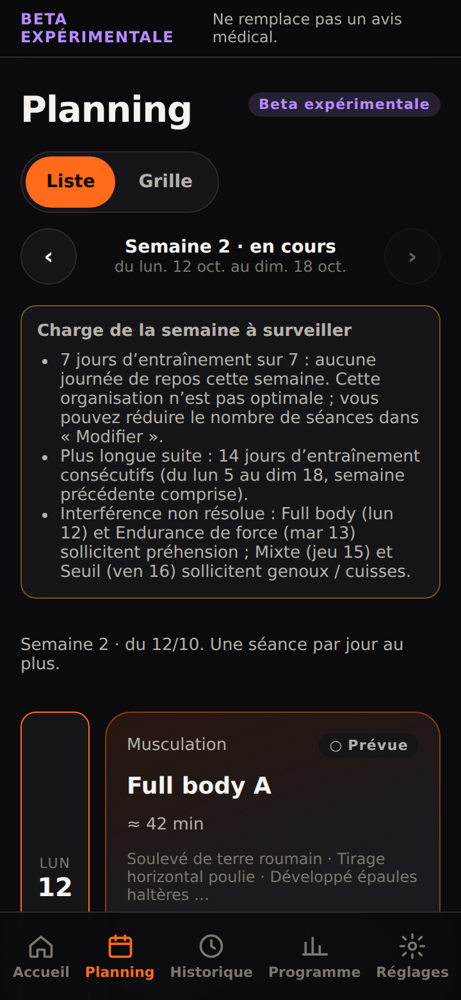 | Liste (inchangée) 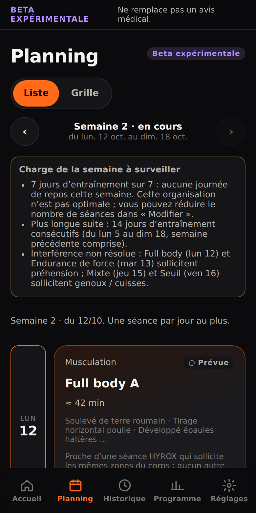 |
| Grille, haut de semaine 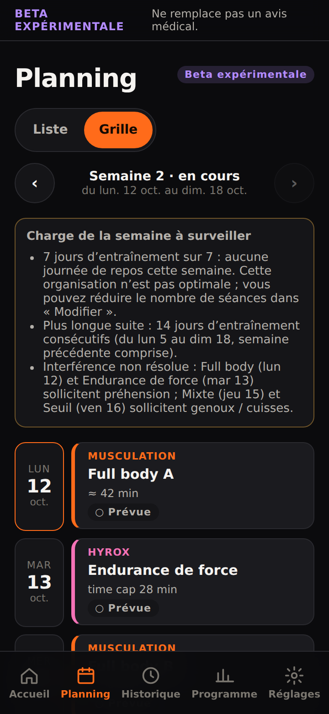 | Grille, haut de semaine 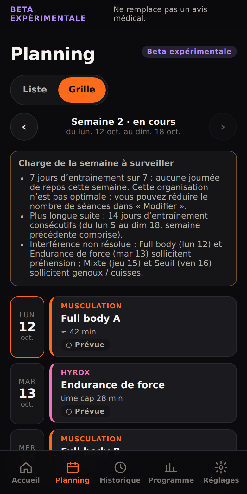 |
| Grille, fin de semaine 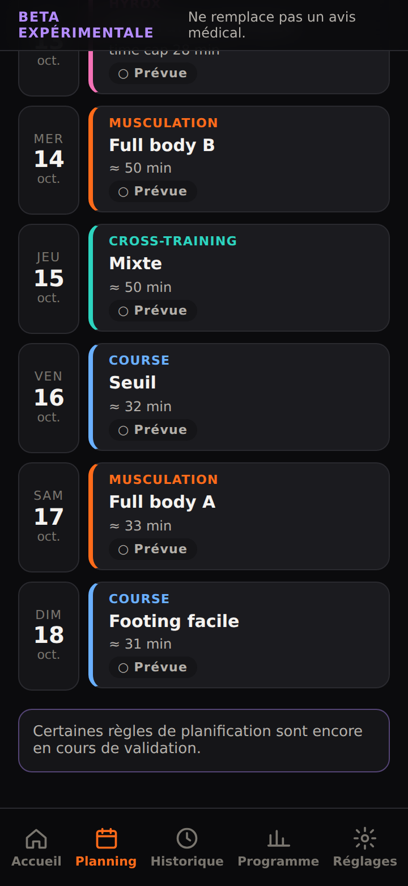 | Grille, fin de semaine 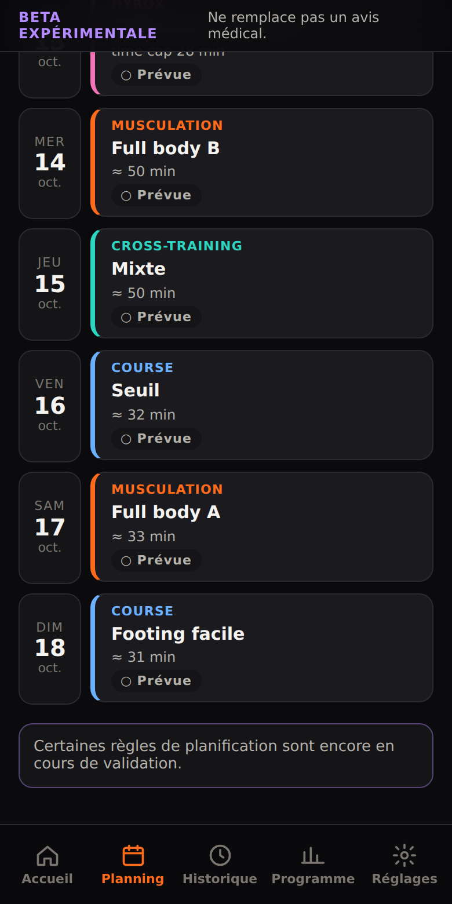 |
| Semaine précédente (statuts réels « Terminée ») 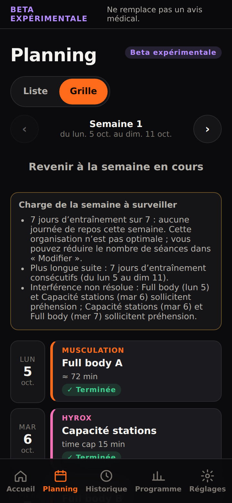 | Semaine précédente 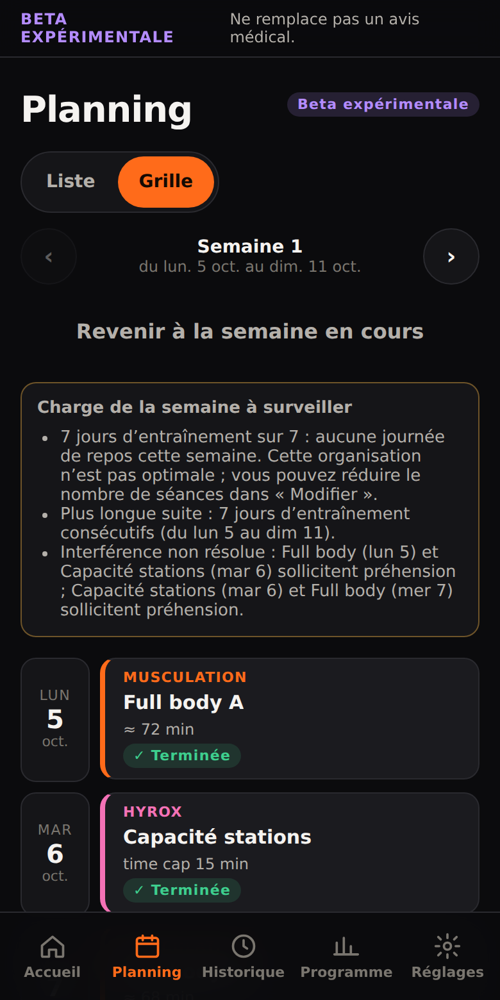 |
| Trois séances le même jour, début de rangée 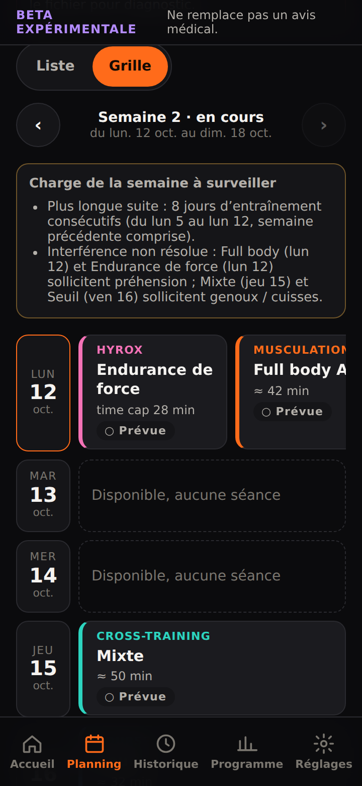 | Trois séances le même jour, début de rangée 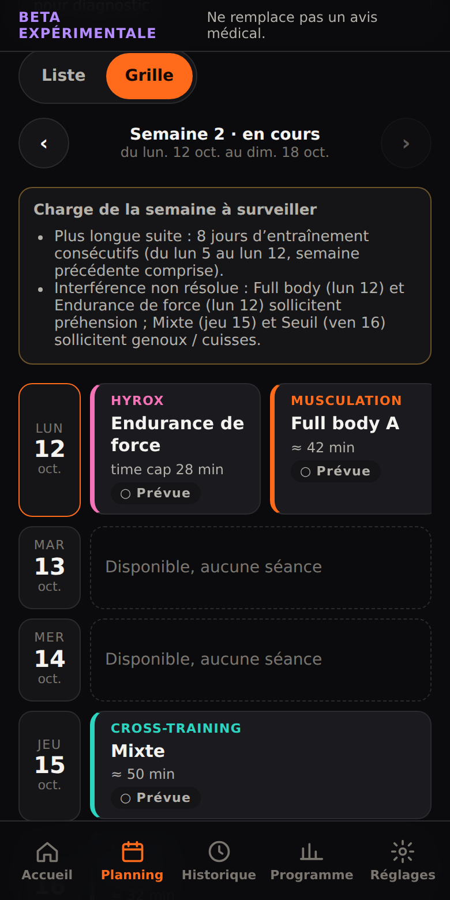 |
| Même jour, rangée défilée : jour et date toujours visibles 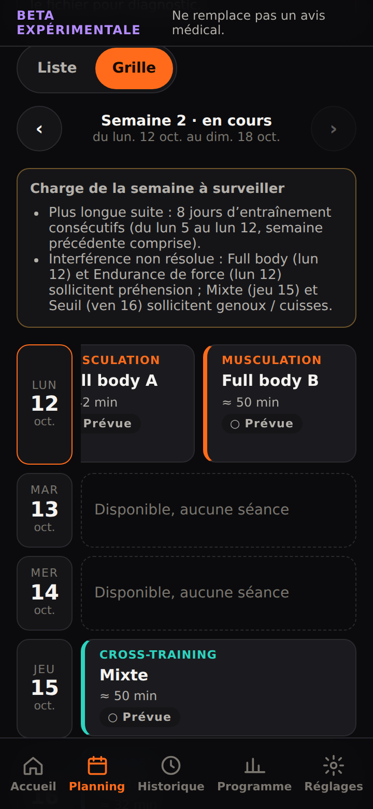 | Même jour, rangée défilée 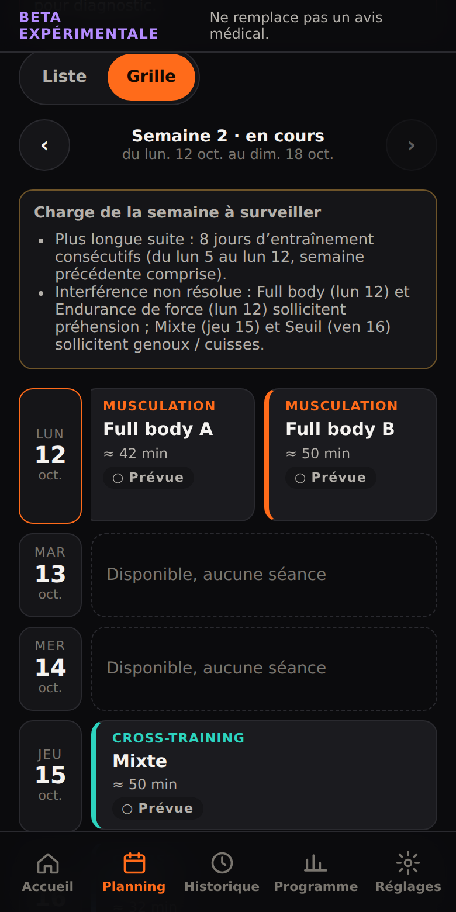 |

**Note sur l'état à plusieurs séances par jour.** Le planificateur actuel ne place qu'une séance par jour (aucun cas sur le banc RC4). L'état « trois séances le même jour » est donc une **fixture d'interface** : deux séances y sont posées sur le jour d'une autre. Pour cette raison, l'application y affiche aussi son avis existant « Incohérence de données » (contrôle d'intégrité inchangé), visible en haut de ces captures. La grille est prête pour plusieurs séances par jour, mais rien n'en crée aujourd'hui.

## 3. Validation

**Tests DOM** (`apps/kairo/tests/r51-planning-grid-dom.test.tsx`, 12 tests, données du chemin réel P5 et P1) :
- **Sélecteur et ordre des jours :** liste par défaut, bascule accessible ; 7 lignes du lundi au dimanche, dans l'ordre des jours de `selectBeta0Week`.
- **Cartes :**
  - une par séance placée, avec sport, nom, durée et statut ;
  - classe de couleur par sport, les 4 sports présents ;
  - plusieurs séances le même jour, côte à côte (« 2 séances »).
- **Repos et statuts :**
  - jours sans séance : « Repos » ou « Disponible, aucune séance » selon la disponibilité (P1) ;
  - statuts réels : semaine réalisée puis semaine planifiée (« Prévue »).
- **Clic :** même appel `onOpen` que la liste ; dans l'application, même fiche de séance ouverte.
- **Navigation :** semaine précédente, semaine suivante bornée, retour à la semaine en cours.
- **Persistance :** Grille puis rechargement ⇒ Grille ; Liste ⇒ Liste.
- **Non-régression :**
  - balisage de la liste identique avant et après un passage par la grille ;
  - **état stocké identique** après bascules et navigation (aucune donnée modifiée).
- **Fixtures E2E :** écrites par le test et relues à l'identique (`tests/fixtures/r51-*.json`).

**E2E mobile** (`scripts/e2e.mjs`, section R5.1) : 360 et 390 px × 2 états, soit **52 vérifications**.
- **Mise en page :**
  - liste par défaut ; sept jours dans l'ordre ;
  - **aucun débordement horizontal de la page (0 px)** ;
  - jour et date dans la fenêtre sur chaque ligne.
- **Lisibilité :**
  - aucun texte superposé ni coupé (sport, durée, statut) ;
  - noms sur deux lignes au plus ;
  - 4 couleurs de sport distinctes.
- **Plusieurs séances le même jour :** trois séances côte à côte, rangée défilante. Après défilement, le jour reste visible et la page ne déborde toujours pas.
- **Interaction :**
  - clic sur une carte de la grille = même séance que depuis la liste ;
  - carte activable au clavier (Entrée) ;
  - navigation vers la semaine précédente ;
  - mode Grille mémorisé après rechargement ;
  - aucune erreur de page.

**Ensemble :**

| Vérification | Résultat |
|---|---|
| `pnpm check` | 2 937 tests réussis, 2 ignorés (déjà ignorés auparavant), lint et types OK |
| `pnpm kairo:build` | OK |
| `pnpm kairo:e2e` | OK (281 vérifications, dont les 52 de R5.1) |

## 4. Points d'attention

- **Navigation dans le mode Liste.** La navigation entre semaines s'affiche dans les deux modes. La liste elle-même est inchangée : elle affiche la semaine choisie, la semaine en cours par défaut.
- **Avertissements de la semaine.** Ils restent au-dessus de la grille, comme dans la liste.
- **Semaines futures.** Elles ne sont accessibles que si elles sont déjà planifiées : aucune planification n'est déclenchée par la navigation.

Aucune fusion vers TEST ou production, aucun déploiement. En attente de votre validation.
